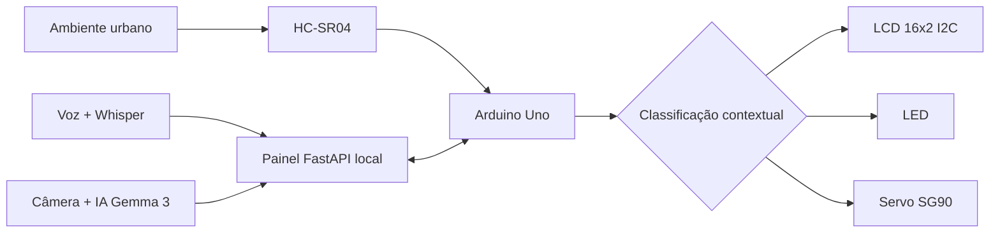

# Roberto CitizenTech — FIAP Global Solution 2026.2

Robô assistivo para identificação de obstáculos em ambientes urbanos e de atendimento. O Roberto mede a distância com o HC-SR04, classifica o contexto, informa a condição no LCD e reage autonomamente com LED e braço articulado. O painel local adiciona comandos por texto/voz, visão computacional e interpretação por IA local.

## Integrantes

- Bruno Venturi Lopes Vieira — RM 99431
- Guilherme Alves de Lima — RM 550433
- Leonardo de Oliveira Ruiz — RM 98901

## Demonstração CitizenTech

O sensor frontal identifica barreiras que podem prejudicar circulação e acessibilidade. A cada 500 ms, o firmware classifica a leitura:

| Distância | Estado | Resposta autônoma |
|---|---|---|
| até 30 cm | Obstáculo | LCD alerta, LED acende e braço levanta |
| 31 a 70 cm | Atenção | LCD alerta, LED acende e braço recolhe |
| acima de 70 cm | Caminho livre | LCD informa, LED apaga e braço recolhe |

A ação ocorre somente quando o estado muda, evitando repetição, tremedeira e consumo desnecessário.

## Arquitetura



## Componentes

- Arduino Uno R3 (ATmega328P, 5 V)
- Sensor ultrassônico HC-SR04
- LCD 16x2 com módulo I2C PCF8574
- Servo SG90
- LED/módulo com resistor em série integrado
- Protoboard de 170 pontos e jumpers
- Suporte para 4 pilhas AA exclusivo para o servo
- Estrutura em MDF 3 mm cortada a laser

## Ligações utilizadas

| Componente | Ligação |
|---|---|
| HC-SR04 TRIG | Arduino D2 |
| HC-SR04 ECHO | Arduino D3 |
| LED | Arduino D6 e GND |
| Servo sinal | Arduino D9 |
| LCD SDA | Arduino A4 |
| LCD SCL | Arduino A5 |
| HC-SR04 e LCD | 5 V e GND do Arduino |
| Servo positivo | positivo do suporte 4xAA |
| Servo negativo | negativo do suporte 4xAA |
| GND comum | negativo das pilhas unido ao GND do Arduino |

O positivo das pilhas não deve ser ligado ao pino 5 V do Arduino. As pilhas alimentam somente o servo. O LCD e o sensor são alimentados pelo Arduino via USB.

## Firmware

Código principal: `03_ARDUINO/Firmware/Roberto/Roberto.ino`.

Calibração física validada:

- braço recolhido: 55°;
- braço levantado: 135°;
- serial: 115200 baud;
- LCD I2C detectado automaticamente em 0x27 ou 0x3F.

Além da autonomia, o firmware aceita mensagens JSON por linha:

```json
{"id":"demo1","action":"SENSOR_READ"}
{"id":"demo2","action":"ARM_UP"}
{"id":"demo3","action":"ARM_DOWN"}
{"id":"demo4","action":"LED_ON"}
{"id":"demo5","action":"LED_OFF"}
{"id":"demo6","action":"WAVE"}
```

## Software e IA

O software está em `04_SOFTWARE_ROBERTO`. Execute `INICIAR_ROBERTO.bat` e abra `http://127.0.0.1:8765`.

- FastAPI: painel e integração hardware/software;
- Whisper local: transcrição em português;
- Gemma 3 4B via Ollama: interpretação de solicitações e imagem;
- Piper: resposta falada em português;
- Webcam: análise contextual sob solicitação;
- Serial USB: comandos identificados e confirmação do Arduino.

Exemplos: “Roberto, levante o braço”, “Roberto, apague a luz”, “Roberto, qual é a distância do obstáculo?” e “Roberto, o que você está vendo?”. A IA funciona localmente; áudio e imagem não são enviados a APIs externas.

## Como reproduzir

1. Monte o circuito conforme a tabela e mantenha as pilhas fora durante a primeira conferência.
2. Grave o firmware no Arduino Uno pela porta serial.
3. Insira as quatro pilhas AA e mantenha o GND comum.
4. Confirme no LCD as três faixas de distância.
5. Em Windows com Python 3.12, instale `04_SOFTWARE_ROBERTO/requirements.txt`.
6. Execute `04_SOFTWARE_ROBERTO/INICIAR_ROBERTO.bat`.
7. Selecione a porta do Arduino no painel e teste texto, voz e câmera.

## Testes realizados

- LCD e HC-SR04 reais: aprovado nas três faixas;
- LED real: aprovado em brilho total;
- servo real: ARM_UP, ARM_DOWN e WAVE aprovados;
- autonomia sensor → decisão → atuadores: aprovada;
- compilação e upload em Arduino Uno/COM3: aprovados;
- suíte Python: **32 testes aprovados** com `python -m pytest -q`.

## Arquivos de fabricação

- Modelo Fusion: `01_FUSION/ROBERTO_MONTADO.f3d`
- Tampa frontal: `02_CORTE_LASER/TAMPA_FRONTAL_MAKER_LCD_HCSR04_LED.dxf`
- Prévia: `01_FUSION/PREVIA_TAMPA_FRONTAL_MAKER.svg`

## Vídeo

[Assista à demonstração do Roberto no YouTube](https://youtu.be/zp226N_uSEo)

## Segurança e LGPD

O processamento de voz e imagem é local e ocorre somente durante a execução. Não há armazenamento rotineiro de áudio, envio de imagens a serviços externos ou coleta obrigatória de dados pessoais. A demonstração deve evitar rostos, placas e informações identificáveis sem autorização.
